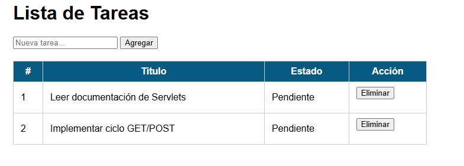
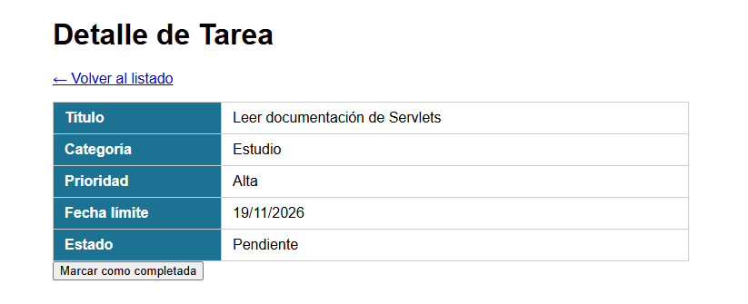

# Post-contenido — Unidad 5: Fundamentos de Java Web (Servlets y JSP)

**Estudiante:** William Felipe Villamizar Soler  
**Código:** 1152498  
**Programa:** Ingeniería de Sistemas  
**Semestre:** Séptimo  
**Asignatura:** Programación Web

## Descripción

Repositorio del laboratorio de la Unidad 5 de Programación Web.

Se desarrolla un único proyecto Maven Web llamado `gestion-tareas`, dividido en dos partes que trabajan sobre el mismo dominio de tareas.

La Parte 1 implementa la gestión básica mediante Servlets, JSP y el patrón Post/Redirect/Get.

La Parte 2 incorpora filtros combinados, una vista de detalle, un segundo Servlet y sesiones HTTP.

## Tecnologías utilizadas

- Java 17
- Maven
- Jakarta Servlet 6.0
- JSP
- JSTL 3.0
- HTML5 y CSS3
- Apache Tomcat 10
- Git y GitHub

## Parte 1 — Servlet de gestión de tareas

Se implementó `TareasServlet` para procesar peticiones HTTP:

- GET: mostrar la lista de tareas.
- POST: agregar nuevas tareas.
- POST: eliminar tareas.
- Validación del título en el servidor.
- Patrón Post/Redirect/Get para evitar el reenvío de formularios.

El modelo `Tarea` contiene inicialmente un identificador, título y estado de finalización.

## Parte 2 — Filtros, detalle y sesión

Se extendió el modelo `Tarea` con los siguientes atributos:

- Categoría.
- Prioridad.
- Fecha límite.

Se implementaron las siguientes funcionalidades:

- Filtrado combinado por texto, categoría y prioridad.
- Persistencia del último filtro mediante HttpSession.
- Identificación y saludo personalizado del usuario.
- Acción para marcar tareas como completadas.
- Vista de detalle de cada tarea.
- Segundo Servlet llamado DetalleTareaServlet.
- Lista compartida mediante ServletContext.
- Hoja de estilos CSS compartida.

## Decisiones de diseño

### 1. Estado compartido de las tareas

La lista de tareas se mantiene como variable de instancia de TareasServlet y se publica mediante ServletContext.

Esto permite compartir los datos entre diferentes peticiones y entre los dos Servlets sin duplicar la lista.

### 2. Uso de HttpSession

El nombre del usuario identificado y los últimos filtros aplicados se almacenan en HttpSession.

Se utiliza la sesión porque estos datos deben mantenerse durante varias peticiones, incluso cuando el usuario navega entre el listado y la vista de detalle.

Los atributos de request solo permanecen disponibles durante una petición.

### 3. ServletContext y applicationScope

DetalleTareaServlet recupera la lista de tareas utilizando:

`getServletContext().getAttribute("tareas")`

Así, ambos Servlets utilizan la misma colección de tareas y se evita duplicar el estado de la aplicación.

### 4. Forward en la vista de detalle

DetalleTareaServlet utiliza RequestDispatcher.forward para enviar el objeto Tarea a detalle.jsp.

Se utiliza forward porque la operación es una consulta GET y no necesita generar otra petición HTTP.

En cambio, las acciones POST utilizan sendRedirect para implementar el patrón Post/Redirect/Get.

### 5. Hoja de estilos externa

Los estilos se trasladaron a:

`src/main/webapp/css/estilos.css`

De esta manera, tareas.jsp y detalle.jsp comparten las mismas reglas CSS sin duplicar código.

## Estructura del proyecto

```text
gestion-tareas/
├── pom.xml
├── README.md
├── img/
│   ├── captura-01.png
│   └── captura-02.png
└── src/
    └── main/
        ├── java/
        │   └── com/ejemplo/
        │       ├── model/
        │       │   └── Tarea.java
        │       └── servlet/
        │           ├── TareasServlet.java
        │           └── DetalleTareaServlet.java
        └── webapp/
            ├── index.jsp
            ├── css/
            │   └── estilos.css
            └── WEB-INF/
                ├── web.xml
                └── views/
                    ├── tareas.jsp
                    └── detalle.jsp
```

## Cómo compilar y desplegar

1. Clonar el repositorio:

   `git clone https://github.com/pipevilla423/villamizar-post2-u5.git`

2. Abrir el proyecto Maven en Visual Studio Code o IntelliJ IDEA.

3. Verificar que estén instalados Java, Maven y Apache Tomcat 10.

4. Ejecutar:

   `mvn clean package`

5. Copiar el archivo `target/gestion-tareas.war` a la carpeta `webapps` de Tomcat.

6. Iniciar Apache Tomcat.

7. Abrir la aplicación:

   http://localhost:8080/gestion-tareas/tareas

## Rutas de la aplicación

| Ruta | Funcionalidad |
|------|---------------|
| `/tareas` | Listado y gestión de tareas |
| `/tareas?q=texto` | Filtro por título |
| `/tareas?cat=Estudio` | Filtro por categoría |
| `/tareas?prioridad=Alta` | Filtro por prioridad |
| `/tareas?cat=Estudio&prioridad=Alta` | Filtro combinado |
| `/tareas/detalle?id=1` | Detalle de una tarea |

## Capturas de pantalla

### Lista de tareas con filtros



### Detalle de una tarea



## Control de versiones

El proyecto utiliza Git y GitHub para registrar los cambios realizados durante ambas partes del laboratorio.

Los commits documentan la implementación del modelo, los Servlets, las vistas JSP, los filtros, las sesiones y las decisiones de diseño.
